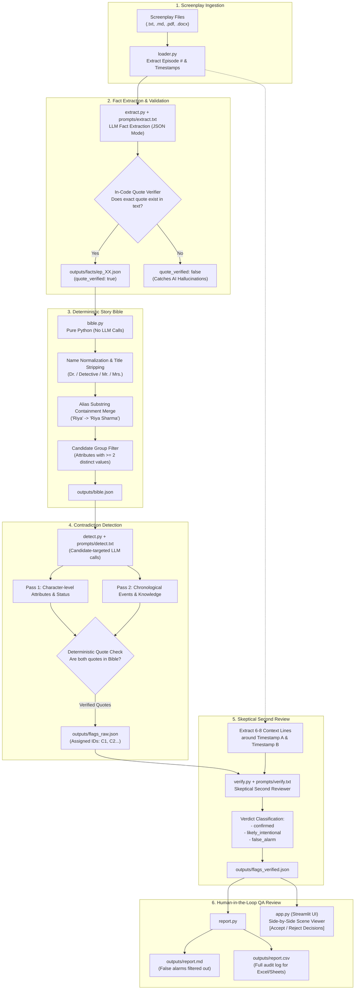

# 🎬 Cross-Episode Continuity Checker for AI Microdramas

An automated narrative continuity verification system designed specifically for **AI-generated microdrama series** (50+ episodes, 1–2 minutes each, dense with fast-paced plot points, relationships, and timestamps).

The system acts as an AI script supervisor and QA editor: reading episode screenplays, extracting structured story facts, tracking characters across episodes, flagging continuity contradictions, and conducting a skeptical second review against the raw screenplay text before human sign-off.

---

## 📌 Table of Contents

- [Problem Statement](#-problem-statement)
- [System Architecture & Data Flow](#-system-architecture--data-flow)
- [Workflow Stages & Detailed Implementation](#-workflow-stages--detailed-implementation)
  - [Stage 1: Screenplay Ingestion (`loader.py`)](#stage-1-screenplay-ingestion-loaderpy)
  - [Stage 2: Fact Extraction & Hallucination Guard (`extract.py`)](#stage-2-fact-extraction--hallucination-guard-extractpy)
  - [Stage 3: Story Bible & Alias Resolution (`bible.py`)](#stage-3-story-bible--alias-resolution-biblepy)
  - [Stage 4: Contradiction Detection (`detect.py`)](#stage-4-contradiction-detection-detectpy)
  - [Stage 5: Skeptical Second Reviewer (`verify.py`)](#stage-5-skeptical-second-reviewer-verifypy)
  - [Stage 6: Reporting & QA Review UI (`report.py`, `app.py`)](#stage-6-reporting--qa-review-ui-reportpy-apppy)
- [Anti-Hallucination & Reliability Safeguards](#-anti-hallucination--reliability-safeguards)
- [Model Providers & Configuration](#-model-providers--configuration)
- [Quickstart & Installation](#-quickstart--installation)
- [Directory Structure](#-directory-structure)
- [Input & Output Schemas](#-input--output-schemas)
- [License](#-license)

---

## 💡 Problem Statement

Microdrama production relies heavily on rapid AI generation workflows. Because individual episodes are generated independently or in small batches, series frequently suffer from critical narrative flaws:
- **Attribute Inconsistencies:** A character is a nurse in Episode 1, but suddenly a chief surgeon in Episode 3 with no explanation.
- **Mortality Impossibilities:** A character actively participates in Episode 12, but is reported to have died 3 years prior in Episode 14.
- **Knowledge Paradoxes:** A character claims *"I have never met Rohit in my life"* in Episode 22, despite being in the same classroom in Episode 4.
- **AI Hallucinations:** Traditional LLM checkers often hallucinate continuity errors by misquoting text that was never in the screenplay.

This pipeline resolves these issues by pairing **structured fact extraction** with **in-code deterministic checks** and **two-pass verification**.

---

## 🏗️ System Architecture & Data Flow



---

## 🔄 Workflow Stages & Detailed Implementation

### Stage 1: Screenplay Ingestion (`loader.py`)
- **Format Support:** Ingests `.txt`, `.md`, `.pdf` (via `pdfplumber`), and `.docx` (via `python-docx`).
- **Episode Number Parsing:** Uses regular expressions (`(?:ep(?:isode)?|[e])[\s\-_]*(\d+)`) to extract episode indices from filenames such as `ep_03.txt`, `Episode 3.pdf`, or `E03`. Falls back to alphabetical indexing if unnumbered.
- **Context Slice (`get_scene_around`):** Retrieves the `~6–8` surrounding lines of dialogue and narration centered around any timestamp string, providing exact context to the verifier.

### Stage 2: Fact Extraction & Hallucination Guard (`extract.py`)
- **LLM Extraction Prompt (`prompts/extract.txt`):** Instructs the model to act as a strict script supervisor, capturing:
  - `CHARACTER`: Name, aliases, age, job, residence.
  - `RELATIONSHIP`: Family, romantic, boss/employee ties.
  - `STATUS`: Alive/dead, married/single, injured/healthy, employed/fired.
  - `EVENT`: Major plot actions.
  - `KNOWLEDGE`: Who knows which secret, and who is unaware.
  - `OBJECT/PLACE`: Key items, amounts of money, locations.
- **In-Code Quote Verifier:** Before saving, Python normalizes the script and verifies that the reported `quote` string appears verbatim in the screenplay. Hallucinated quotes are flagged (`quote_verified = False`).
- **Disk Caching:** Saves each episode to `outputs/facts/ep_XX.json` and skips re-extraction on subsequent runs.

### Stage 3: Story Bible & Alias Resolution (`bible.py`)
- **Deterministic Python Execution:** Operates without LLM calls, ensuring 100% repeatable, cost-free execution.
- **Title Stripping & Normalization:** Strips honorifics (`Dr.`, `Mr.`, `Mrs.`, `Inspector`, `Nurse`, `Detective`) and standardizes casing.
- **Alias Containment:** Merges character profiles when one name is a substring or token subset of another (e.g., merging `"Riya"` into `"Riya Sharma"`). Logs every merge to the console.
- **Candidate Filtering (`find_candidates`):** Extracts only attributes possessing 2 or more distinct values across episodes, as well as multiple entries for `STATUS` and `RELATIONSHIP` facts.

### Stage 4: Contradiction Detection (`detect.py`)
- **Targeted Context Windows:** Instead of feeding 50 full scripts to an LLM, sends only candidate facts per character to `prompts/detect.txt`.
- **Two-Pass Detection:**
  1. *Character Attributes & Status Pass:* Checks for impossible professions, relationships, and mortality states.
  2. *Chronological Events & Knowledge Pass:* Evaluates chronological events and secret knowledge to catch paradoxes (e.g., a character claiming they never met someone they previously met).
- **Code-Level Hallucination Guard:** Drops any flag where either `quote_a` or `quote_b` cannot be verified against the story bible.
- **Output:** Saves candidate flags with unique sequential IDs (`C1`, `C2`...) to `outputs/flags_raw.json`.

### Stage 5: Skeptical Second Reviewer (`verify.py`)
- **Raw Scene Context:** Extracts the actual 6–8 lines from the original episodes surrounding both conflicting timestamps.
- **Skeptical Prompt (`prompts/verify.txt`):** Challenges the initial flag by asking:
  1. Does each quote really appear in the screenplay?
  2. Is there an in-universe narrative explanation (a lie, elapsed time, disguise, twin, sarcasm)?
- **Classification:** Categorizes each flag as:
  - `confirmed`: Genuine, unexplainable continuity violation.
  - `likely_intentional`: Plausible character deception or unexplained plot twist.
  - `false_alarm`: Misinterpretation, non-contradictory context, or explained change.
- **Output:** Saves to `outputs/flags_verified.json`.

### Stage 6: Reporting & QA Review UI (`report.py`, `app.py`)
- **Markdown QA Report (`outputs/report.md`):** Automatically excludes `false_alarm` items and orders actionable items by Severity (`Major` > `Minor`) and Confidence (`High` > `Medium` > `Low`), formatted with interactive `[ ] accept [ ] reject` checkboxes.
- **Spreadsheet Audit (`outputs/report.csv`):** Contains all flags (including false alarms with their verdicts) for spreadsheet tracking and auditing.
- **Streamlit Web Application (`app.py`):**
  - Interactive file uploader.
  - Real-time pipeline progress bar.
  - Side-by-side screenplay context viewer.
  - One-click Accept/Reject buttons with color-coded status badges.
  - Instant download buttons for markdown and CSV reports.

---

## 🛡️ Anti-Hallucination & Reliability Safeguards

1. **Exact Substring Verification in Code:** Every extracted quote is verified by code against the raw script. An LLM cannot fabricate evidence.
2. **Deterministic Story Bible:** Alias merging and candidate generation are executed with deterministic Python algorithms rather than generative calls.
3. **Double-Ended Quote Validation:** Any contradiction flag where the model invents a quote is eliminated before entering the verification stage.
4. **Context Injection for Second Reviewer:** The second reviewer is provided raw dialogue lines before and after each quote to prevent out-of-context misinterpretations.
5. **Disk Response Caching:** Hashes `(provider, model, system, prompt, json_mode)` via SHA-256 into `outputs/cache/` to protect free-tier API quotas.
6. **Exponential Backoff:** Automatically retries API calls on rate-limit errors (`429`, `ResourceExhausted`) with backoff timings (`2s`, `4s`, `8s`).

---

## 🤖 Model Providers & Configuration

The system connects through `llm.py` using a unified interface and can switch providers by editing `.env`:

| Provider | Supported Models | `.env` Setting | Required Key |
| :--- | :--- | :--- | :--- |
| **OpenRouter** *(Default)* | `nvidia/nemotron-3-ultra-550b-a55b:free`<br>`nvidia/llama-3.1-nemotron-70b-instruct`<br>`meta-llama/llama-3.3-70b-instruct` | `PROVIDER=openrouter` | `OPENROUTER_API_KEY` |
| **Google Gemini** | `gemini-1.5-flash`<br>`gemini-1.5-pro` | `PROVIDER=gemini` | `GEMINI_API_KEY` |
| **Anthropic** | `claude-3-5-sonnet-20241022`<br>`claude-3-5-haiku-20241022` | `PROVIDER=anthropic` | `ANTHROPIC_API_KEY` |
| **OpenAI** | `gpt-4o`<br>`gpt-4o-mini` | `PROVIDER=openai` | `OPENAI_API_KEY` |

---

## 🚀 Quickstart & Installation

### 1. Clone & Set Up Environment
```bash
# Clone the repository
git clone https://github.com/himanshu9330/promo_split_error_finder.git
cd promo_split_error_finder

# Create and activate Python 3.10+ virtual environment
python -m venv .venv
# On Windows:
.venv\Scripts\activate
# On macOS/Linux:
source .venv/bin/activate

# Install dependencies
pip install -r requirements.txt
```

### 2. Configure Credentials
Copy `.env.example` to `.env` and insert your API key:
```bash
cp .env.example .env
```
Example `.env`:
```env
PROVIDER=openrouter
MODEL_NAME=nvidia/nemotron-3-ultra-550b-a55b:free
OPENROUTER_API_KEY=sk-or-v1-your-key-here
```

### 3. Launch the Streamlit Web Application
```bash
streamlit run app.py
```
Open your browser at `http://localhost:8501`.

### 4. Optional: Run Pipeline via Command Line
```bash
# 1. Place episode scripts into data/episodes/
# 2. Extract facts
python extract.py

# 3. Build story bible
python bible.py

# 4. Detect contradictions
python detect.py

# 5. Verify against raw scene contexts
python verify.py

# 6. Generate reports
python report.py
```

---

## 📂 Directory Structure

```text
promo_split_error_finder/
├── .env.example               # Environment template for API keys & model selection
├── .gitignore                  # Ignores sensitive keys (.env), data/, outputs/, cache
├── README.md                   # Complete architectural and workflow documentation
├── requirements.txt            # Python dependencies (streamlit, pandas, openai, etc.)
│
├── app.py                      # Interactive Streamlit QA dashboard
├── config.py                   # Global configuration & defaults
├── llm.py                      # Model wrapper with caching, retries, and JSON parsing
├── loader.py                   # Screenplay parser (.txt, .md, .pdf, .docx) & scene context
├── extract.py                  # Fact extraction & in-code quote validation
├── bible.py                    # Deterministic alias merging & story bible construction
├── detect.py                   # Multi-pass contradiction detection & hallucination filter
├── verify.py                   # Skeptical second reviewer verifying original scene scripts
├── report.py                   # QA report builder (outputs/report.md, outputs/report.csv)
├── evaluate.py                 # Evaluation framework for planted-error test suites
│
├── prompts/
│   ├── extract.txt             # Script supervisor fact extraction prompt
│   ├── detect.txt              # Strict continuity checker prompt
│   └── verify.txt              # Skeptical second reviewer prompt
│
├── data/
│   └── episodes/               # Input screenplay files (.txt, .md, .pdf, .docx)
│
└── outputs/
    ├── facts/                  # Per-episode extracted facts JSON (ep_01.json, etc.)
    ├── cache/                  # SHA-256 disk cache for LLM API calls
    ├── bible.json              # Aggregated story bible with resolved aliases
    ├── flags_raw.json          # Unverified contradiction flags from detect stage
    ├── flags_verified.json     # Verified flags with verdicts and reasoning
    ├── report.md               # Human-ready QA report (false alarms excluded)
    ├── report.csv              # Full spreadsheet report with all flags
    └── run_log.txt             # Call metrics (duration, token/char length, errors)
```

---

## 📋 Input & Output Schemas

### Extracted Fact Schema (`outputs/facts/ep_01.json`)
```json
{
  "episode": 1,
  "facts": [
    {
      "id": "E1-01",
      "type": "CHARACTER",
      "subject": "Riya Sharma",
      "attribute": "job",
      "value": "night nurse at City Hospital",
      "timestamp": "00:42",
      "source": "dialogue",
      "speaker": "Riya",
      "reliability": "reliable",
      "quote": "I work as a night nurse at City Hospital.",
      "quote_verified": true
    }
  ]
}
```

### Verified Flag Schema (`outputs/flags_verified.json`)
```json
{
  "id": "C1",
  "type": "attribute",
  "subject": "riya sharma",
  "fact_a": {
    "episode": 1,
    "timestamp": "00:42",
    "quote": "I work as a night nurse at City Hospital."
  },
  "fact_b": {
    "episode": 3,
    "timestamp": "01:15",
    "quote": "I am the chief cardiothoracic surgeon at Metro Clinic."
  },
  "explanation": "Riya is introduced as a nurse in Episode 1, but states she is a surgeon in Episode 3.",
  "severity": "major",
  "confidence": "high",
  "could_be_intentional": false,
  "verdict": "confirmed",
  "reasoning": "The original scenes confirm two incompatible professions within two weeks of story time."
}
```

---

## 📄 License
MIT License. Built for microdrama production studios, screenwriters, and AI script QA teams.
